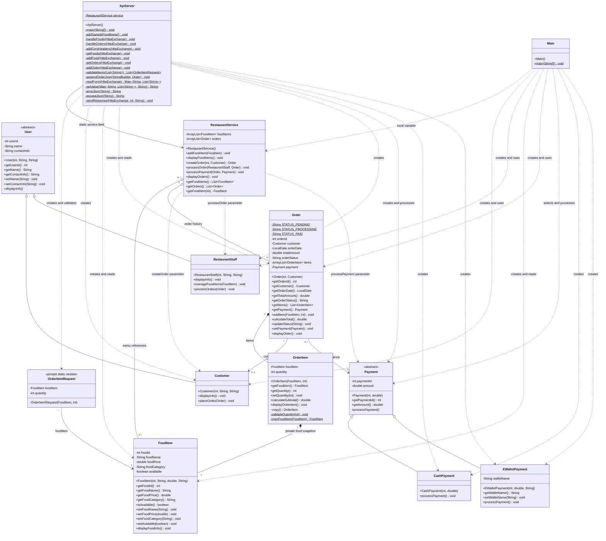

# DineFlow class diagram

The diagram reflects the Java classes under `backend/src/main`. In Mermaid,
`$` marks static members and `*` marks abstract methods.

`Order` contains zero or more `OrderItem` snapshots. Each order has zero or one
payment reference; the code does not prevent the same `Payment` object from
being assigned to multiple orders, hence the `0..*` multiplicity at the
`Order` end. An `Order` can also be constructed with a null customer, so the
customer multiplicity is optional in the diagram. `OrderItemRequest` is a
private static nested helper in `ApiServer`; its fields are `final` in Java.
The status constants in `Order` are also `static final`.
`ApiServer()` and `Main()` are compiler-generated public default constructors;
they are shown to reflect the classes' Java-visible constructors.
